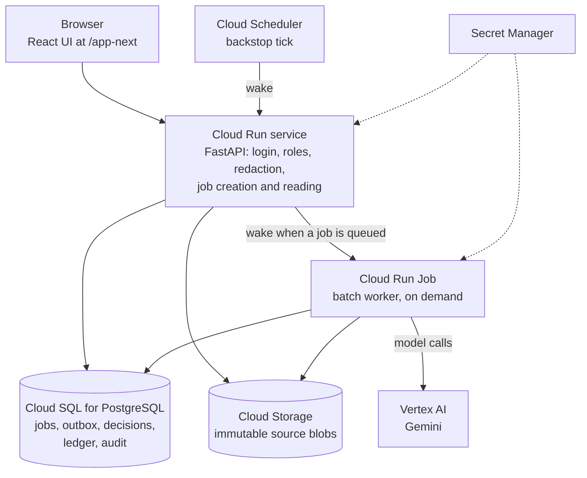
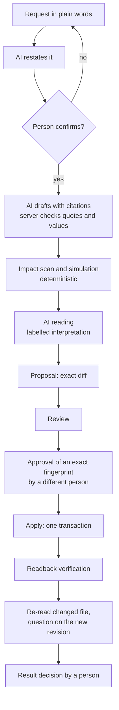
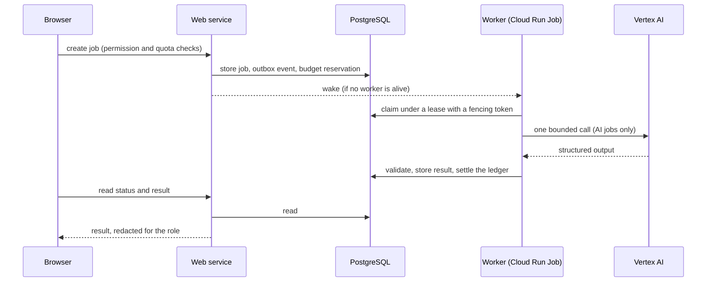

# Ripple

**Ripple is a change-coordination layer for the business rules that live inside existing systems.** A person states a rule change in plain words; Ripple restates it, finds the evidence in the sources, shows what would change and what stays unresolved, measures the effect by running the real program, and then hands the decision to people. AI understands, asks and drafts; deterministic code checks and executes; people clarify, approve and accept.

> **Status in one paragraph.** This repository is a working prototype of **Phase 1 — Prove the Loop**: the mechanism is demonstrated end to end on **one bounded, reproducible sample system (Harbor)**. It is not a production system, it is not validated beyond Harbor, and the one held-out evaluation of the AI-assisted analysis stages (snapshot 2026-10-02) **did not reach its targets** (see [Evidence, limitations and future work](#12-evidence-limitations-and-future-work)). **Phase 2 — Scale the Intelligence** (wider coverage, better AI quality, domain integration, user validation) is proposed, not built.

## Judge Quick Path

Ripple can be judged without running the whole journey. Times are suggestions, not guarantees: the first AI step after a quiet period can take about a minute while the worker starts.

| | |
|---|---|
| **Working prototype** (Google Cloud Run) | <https://pitchrc---ripple-s6pcepa2cq-as.a.run.app/app-next/> (sign in with the judge account from the submission materials) |
| **Judge guide** (static, read-only) | <https://ripple-guide-636767063018.asia-southeast1.run.app> |
| **Deck / video** | to be linked here once the final versions are approved |

1. **Understand the problem and Harbor** (reading only, no AI). [Product introduction](#1-product-introduction) and the [judge guide](docs/judges/START_HERE.md): Harbor is a synthetic procurement system in which one approval rule is written in configuration, policy and spreadsheet at once.
2. **Try the AI understanding** (**calls the AI**). In the prototype open **Changes**, paste the request from [the one-role guide](docs/judges/SINGLE_ROLE_GUIDE.md#the-request-to-type) and press **Send**. Read the card "This is what I understood" and, if it is right, confirm it (confirming does not call the AI). **You may stop at this preview**; you do not need to run the later steps to judge the AI's understanding.
3. **Optional: continue to a proposal.** Draft and AI reading call the AI; impact, simulation and proposal do not. The path ends at "Waiting for the approver" by design ([Scenario A](#scenario-a--one-role-judge-path-agent-self-check)).
4. **Read the recorded Case B** (no sign-in, no AI): [`docs/judges/VERIFIED_FOUR_ROLE_CASE.md`](docs/judges/VERIFIED_FOUR_ROLE_CASE.md), the downstream steps (review, approval, apply, verification, abstention) that a judge account cannot perform.
5. **Read the engineering evidence**: [five claims with their evidence](#five-claims-and-where-to-check-them) below, [`docs/release/CLAIMS_EVIDENCE_LIMITS.md`](docs/release/CLAIMS_EVIDENCE_LIMITS.md) and the [held-out evaluation, whose targets were not met](docs/evaluation/HELD_OUT_EVALUATION.md).

The full journey remains available: [How to experience the prototype](#how-to-experience-the-prototype).

**AI use and limits.** Sending the request in step 2 starts one metered AI job; if Ripple asks a clarifying question, each answer is another metered AI turn (at most 6 per conversation). Quotas are per account and shared by everyone using that account: 12 AI jobs per account per day, and all AI use also shares one provider budget, so the budget can run out before a quota does. The Quick Path does not guarantee a fixed number of AI calls. It does not replace the downstream evidence and does not remove any limit stated in this README.

**A representative result (Case B, human-operated, recorded 2026-10-13).** The deterministic simulation (**measured**) shows 15 of 240 sample requisitions change route; the approved edit to `approval.yaml` was applied and readback verification **PASSED**; three other sources still say 2,000,000, so the question on the new revision **ABSTAINED**; final acceptance is **pending**. It is one recorded case on one sample system, not a claim about other systems or about AI accuracy.

## Five claims and where to check them

Each row names its own evidence level and snapshot; numbers from different runs are not added together. Scenario A (agent self-check, proposal only) and Case B (human-operated, applied) are different runs and are not mixed.

| Claim | Evidence | Evidence level and snapshot | Limitation |
|---|---|---|---|
| **AI understanding and drafting.** A plain request is restated by AI and confirmed by the person; a draft cites sources and keeps unresolved items visible | [`SCENARIO_STATUS.md`](docs/release/SCENARIO_STATUS.md) (Scenario A, stages 1-3); [`SINGLE_ROLE_GUIDE.md` "What was run, and what was not"](docs/judges/SINGLE_ROLE_GUIDE.md#what-was-run-and-what-was-not); [`CLAIMS_EVIDENCE_LIMITS.md`](docs/release/CLAIMS_EVIDENCE_LIMITS.md) rows 1-3; offline `tests/pitch_brief/test_change_draft.py`, `test_intent_chat.py` | Scenario A, agent self-check, 2026-10-13: the exact wording was run once to the confirmed understanding (1 AI job); the draft was observed in a different run | The exact wording was not run continuously from request to proposal; AI wording varies between runs |
| **Deterministic simulation.** Impact is measured by running Harbor's own program, separate from any AI reading | [`tests/pitch_brief/test_harbor_sim.py`](tests/pitch_brief/test_harbor_sim.py); Scenario A: 35 of 240 ([`SINGLE_ROLE_GUIDE.md`](docs/judges/SINGLE_ROLE_GUIDE.md#step-5---impact-and-simulation)); Case B: 15 of 240 ([`VERIFIED_FOUR_ROLE_CASE.md`](docs/judges/VERIFIED_FOUR_ROLE_CASE.md#step-6---impact-and-simulation)) | Measured. Scenario A: agent self-check, offline expectation identical. Case B: human-operated, 2026-10-13 | Harbor's program only; five integer keys of `approval.yaml`; documents and workbooks are not simulated |
| **Different-person approval, apply and verification.** An approver other than the requester approves an exact fingerprint; apply writes once; the written bytes are re-read | [`VERIFIED_FOUR_ROLE_CASE.md` steps 9-11](docs/judges/VERIFIED_FOUR_ROLE_CASE.md#step-9-10---review-and-approval); `tests/pitch_brief/test_permission_matrix.py`, `test_role_model.py` | Case B, human-operated (one person operated four accounts), 2026-10-13: apply COMPLETED, verification PASSED | Final acceptance pending; loop status PARTIAL; live apply proven for YAML typed edits only |
| **Unresolved sources and abstention.** Sources that disagree stay open; after the change the system abstains instead of picking a value | [`VERIFIED_FOUR_ROLE_CASE.md` step 13](docs/judges/VERIFIED_FOUR_ROLE_CASE.md#step-13---ask-again); [`CLAIMS_EVIDENCE_LIMITS.md`](docs/release/CLAIMS_EVIDENCE_LIMITS.md) row 6 | Case B, live AI answer, 2026-10-13 | The model declares which files it examined and the server checks that declared scope; this is a scope check, not proof that every file was understood. Abstaining means the disagreement is open, not that the knowledge is right |
| **Job reliability and budget.** Jobs run through a Postgres outbox with leases; every AI call has a budget reservation, a pinned model and an attempt limit; the evaluation window is enforced in code | [`CLAIMS_EVIDENCE_LIMITS.md`](docs/release/CLAIMS_EVIDENCE_LIMITS.md) rows 8-10; `tests/pitch_brief/test_worker_wake.py`, `test_trial_window.py`, `test_sim_analysis_budget.py` | Offline tests with fakes; timings and cost are single cloud samples (read 2026-10-14); test results by snapshot in [Testing](#10-testing) | No hard cap on web compute or total infrastructure cost; cost is a price-snapshot estimate, not a bill; web cold start from zero not measured |

Quality of the AI stages is a separate, unfavourable record: the one held-out evaluation did **not** reach its targets ([section 12](#12-evidence-limitations-and-future-work)).

## Contents

Start: [Judge Quick Path](#judge-quick-path) · [Five claims](#five-claims-and-where-to-check-them)

1. [Product introduction](#1-product-introduction)
2. [Start here — for judges](#2-start-here--for-judges)
3. [What you can evaluate](#3-what-you-can-evaluate)
4. [Feature overview](#4-feature-overview)
5. [Architecture](#5-architecture)
6. [Roles and decision boundaries](#6-roles-and-decision-boundaries)
7. [Supported scope](#7-supported-scope)
8. [Repository map](#8-repository-map)
9. [Local setup](#9-local-setup)
10. [Testing](#10-testing)
11. [Deployment and operations](#11-deployment-and-operations)
12. [Evidence, limitations and future work](#12-evidence-limitations-and-future-work)
13. [Submission and third-party information](#13-submission-and-third-party-information)

---

## 1. Product introduction

### The problem

The rules that run a business — an approval threshold, a routing condition, a payment term — are written down in several places at once: configuration files, spreadsheets, policy documents and code. Business owners know what a rule *should* mean but cannot see what the systems do; engineers can see the implementation but cannot decide its meaning. When a rule changes, each hand-off (intent → documents → implementation → testing → decision) can lose meaning, and the places often **already disagree before anyone asks for a change**.

AI that edits code does not by itself know whether a change is right for the business. Ripple addresses the step before and after the edit: *what should change, what else is affected, what is still unresolved, and did the written result match what was approved?*

### What Ripple does

| Step | What Ripple does | Who does the work |
|---|---|---|
| Read | Imports sources as byte-immutable revisions and proposes cited rules, each with a verbatim quote the server re-checks | AI proposes · server checks |
| Clarify | Turns disagreements between sources into questions for the right person; decisions are recorded, never guessed | server detects · people decide |
| Understand the request | Restates a plain-language request, asks if something is unclear, and waits for the person to confirm | AI restates · person confirms |
| Draft | Classifies every affected place (edit / manual / unresolved / excluded) with citations; the server derives the supported edit | AI drafts · server checks |
| Assess | Runs the sample system's own program before and after the edit to **measure** impact; an AI reading is stored separately as interpretation | code measures · AI explains |
| Decide | Review, approval of an **exact fingerprint** by a different person, apply, readback verification, and a final result decision | people decide · code enforces |
| Keep knowledge linked | Re-reads the changed file, keeps unresolved items open, and answers a question on the new revision — or **abstains** when sources still disagree | AI answers or abstains · server checks |

**Harbor** is the vertical used to prove this: a runnable procurement system (approval routing, emergency purchases, invoice matching) plus the documents a business would keep around it. Ripple is not a Harbor threshold calculator: Harbor is the test bed that makes the loop reproducible, because it has the real problem shape (one rule, several sources that can disagree) and can be executed. Reuse beyond Harbor is a **design claim, not yet validated**.

### Scope of Phase 1

Stated as capabilities, not as completion:

- Reads seven file extensions (six formats) with citations ([details](#7-supported-scope)).
- Plain-language request → confirmed understanding → cited draft → impact and simulation → proposal → review → approval of an exact fingerprint → apply → readback verification → question on the new revision.
- Simulation executes **Harbor's own program** only; a change to a document or workbook is not simulated.
- Applies **numeric changes of one existing rule value**. Typed YAML edits were applied live; typed workbook edits exist in code and offline tests but were not proven live.
- Human acceptance of the result is a separate gate and is **pending** in the one recorded four-role case.

---

## 2. Start here — for judges

| What | Where |
|---|---|
| **Working prototype** (Google Cloud Run) | <https://pitchrc---ripple-s6pcepa2cq-as.a.run.app/app-next/> |
| **Judge guide** (static, read-only) | <https://ripple-guide-636767063018.asia-southeast1.run.app> |
| One-role guide (Markdown source) | [`docs/judges/SINGLE_ROLE_GUIDE.md`](docs/judges/SINGLE_ROLE_GUIDE.md) |
| Recorded four-role case (Markdown source) | [`docs/judges/VERIFIED_FOUR_ROLE_CASE.md`](docs/judges/VERIFIED_FOUR_ROLE_CASE.md) |
| Replay guide for the four-role case | [`docs/judges/FOUR_ROLE_REPLAY_GUIDE.md`](docs/judges/FOUR_ROLE_REPLAY_GUIDE.md) |
| Stage-by-stage status of both scenarios | [`docs/release/SCENARIO_STATUS.md`](docs/release/SCENARIO_STATUS.md) |

### How to experience the prototype

1. **Read the guide first** (about five minutes): it explains Harbor, the two scenarios and the labels used for evidence.
2. **Sign in** with the judge account provided in the submission materials. No password, token or cookie is stored in this repository.
3. **Follow the one-role path** ([scenario A](#scenario-a--one-role-judge-path-agent-self-check)): open **Changes**, paste the request from the guide, read the AI's restatement, confirm it, then generate the draft, run impact and simulation, ask for the AI reading and prepare the proposal. The path **stops at "Waiting for the approver"** — a judge cannot go further, by design.
4. **Read the recorded four-role case** ([case B](#case-b--recorded-four-role-case-human-operated)) to see what happens after a proposal. It is a historical record, not something a judge repeats.

### What a judge account can and cannot do

A judge works on **sources that were imported and analysed in advance**. A judge can state a request, confirm their own request, use the AI (metered), and prepare a change **up to a proposal**. A judge **cannot import sources, run extraction, review, approve or apply**, and cannot see raw source quotes. The server enforces this (the page also hides the actions): on 2026-10-14 a judge session was refused with `403 permission denied: source.import` on the import route, and the import panel was absent from the Sources page. People who share one judge account share its chats, "My work" list, history and AI quota; everyone in the workspace can read its stored jobs and history.

### Availability and waiting times

- **AI steps are open until 2026-11-06 23:59:59 SGT** (= 2026-11-06 15:59:59 UTC = 2026-11-07 00:59:59 JST). The web service refuses new AI jobs a few minutes before the end; the worker claims nothing after it. Refusals come with an explanation and charge nothing.
- **AI availability and stored results are different things.** Pages that show stored results do not start AI jobs. Hosting after the deadline is not promised.
- **Quotas are ceilings, not promises:** at most 6 AI turns per conversation and 12 AI jobs per account per day in the evaluation deployment; all AI use also shares one provider budget, so the budget can run out before a quota does.
- **Waiting times are single samples, not guarantees.** The worker starts on demand: about 6 s after a request, 14–23 s for a simple job, and the first AI step after a quiet period can take about a minute (the exact one-role request took about 18 s with a warm worker; an earlier, different request took about 41 s including a cold worker start and two clarifications). A cold web instance was not separately measured. On 2026-10-14 the Overview page showed its "My work" card after about 16 s, because the page waits for its whole summary to load (one call took about 12 s); the same list appears immediately on the Changes page.

---

## 3. What you can evaluate

Two scenarios, **never mixed**: they use different rules, baselines, runs and evidence levels.

Evidence labels used throughout this repository:

| Label | Meaning |
|---|---|
| **Measured** | computed by running Harbor's program (deterministic simulation) |
| **AI interpretation** | what a model read or wrote; labelled as such, never a measurement |
| **Offline expectation** | computed from the shipped sample data by a test, not observed on the deployed system |
| **Agent self-check** | a run by an agent on the deployed prototype, with the project team's sessions |
| **Human-operated** | steps performed by a person through the UI |
| **Business acceptance** | a person accepting the result; a separate human gate |

### Scenario A — one-role judge path (agent self-check)

| | |
|---|---|
| **Problem** | A standard purchase requisition goes to a manager above a threshold. The configuration the program reads says 500,000 JPY; other sources state a manager limit of 1,000,000 JPY or have their own rows. Which requisitions change route, and which statements disagree? |
| **Input** | "Please raise the standard manager approval threshold from 500,000 JPY to 800,000 JPY in the approval configuration. Keep this change limited to approval.yaml and keep any other source that states a manager threshold visible as unresolved." |
| **Allowed stages** | request → confirmation → draft → impact → simulation → AI reading → proposal |
| **Output / stop** | A proposal for `approval.yaml` 500,000 → 800,000 JPY, **proposed, not applied**, waiting for a reviewer and an approver |
| **Measured** | 35 of 240 sample requisitions change route, all NEEDS_MANAGER → AUTO. Offline expectation identical (`tests/pitch_brief/test_harbor_sim.py`) |
| **What was run** | The exact wording was run once through the AI up to the confirmed understanding (1 AI job, READY, current and new value quoted from the person's words, 0.0155 USD). Draft → proposal were observed in a **different run with different wording and the same values**, which needed the manual fallback "Edit the details myself" once |
| **Not verified** | One continuous run of the exact wording from request to proposal |

Note that the sentence "limited to approval.yaml" is **recorded as a note, not enforced**.

### Case B — recorded four-role case (human-operated)

| | |
|---|---|
| **Problem** | The CAPEX finance review threshold is 1,500,000 JPY in `approval.yaml` (the value the program reads) but 2,000,000 JPY in `workflow.yaml`, `approval_matrix.xlsx` and `procurement_policy.md` |
| **Request** | Lower it to 1,000,000 JPY in the approval configuration only (the wording was scripted for the participant) |
| **Who did what** | Requester stated, confirmed, drafted and applied; an administrator answered one open question; an approver set the check and approved the exact fingerprint; a reviewer read the evidence. One person (the project owner) operated the four accounts, steps 1–13, on 2026-10-13 |
| **Measured** | 15 of 240 requisitions change route, all NEEDS_MANAGER → NEEDS_FINANCE (7 standard, 8 emergency CAPEX). The AI reading was stored separately as interpretation |
| **Applied / verified** | Applied by the requester account; machine verification **PASSED** (the file was re-read and holds 1,000,000) |
| **Question after the change** | **ABSTAINED**: `approval.yaml` now says 1,000,000, the other three sources still say 2,000,000. The system did not pick a value. The answering model declared all 13 authorised files examined; the server accepts a "not found" only when that declared scope equals the authorised list — a scope check, **not proof that every file was understood** |
| **Final state** | Loop status **PARTIAL**; result and knowledge **not accepted**; **final acceptance pending**. Cost: 7 AI jobs, 0.1504 USD of verified provider usage |

How to read it correctly:

- **ABSTAINED is a correct outcome when sources disagree.** It does not mean the knowledge is right; it means the disagreement is still open.
- The recorded case is **history**. It ran on 2026-10-13; fixes made afterwards (a defect in how a model "exclude" could close an item, a corrected limits text, the terminal re-analysis behaviour, the worker-seconds counter) are not retro-fitted to it, and the case was not re-run on the current code. The prototype now runs the code of this repository (see [Deployment](#11-deployment-and-operations)).
- No screenshot of case B exists; the guide uses a diagram and two clearly labelled illustration images from an earlier run.
- The shipped Harbor fixture holds 1,000,000 (manager) and 2,000,000 (CAPEX) in `approval.yaml`; the baselines above (500,000 and 1,500,000) are the values of the deployed workspace after earlier applied revisions.

---

## 4. Feature overview

| Capability | Input → output | AI / deterministic / human | Main limit | Implementation |
|---|---|---|---|---|
| **Source import and knowledge** | files → immutable source revision with observations and locators; refused files listed per file | deterministic; AI proposes cited rules (extraction) | seven extensions; no Word/PDF/PowerPoint | [`core/change_intelligence/v2/source_admission.py`](core/change_intelligence/v2/source_admission.py), [`infra/worker/extraction.py`](infra/worker/extraction.py) |
| **Explorer** | rules → tree with source, quote, status, history | server | reading and confirming, no editing of sources | [`frontend/src/features/explorer`](frontend/src/features/explorer) |
| **Questions and decisions** | disagreements and gaps → questions; answers → append-only decisions | detection deterministic; **human** decides | a new decision makes in-flight drafts stale | [`infra/v2_gap_routes.py`](infra/v2_gap_routes.py), [`frontend/src/features/questions`](frontend/src/features/questions) |
| **Free-text request** | sentence → structured understanding (subject, current value, requested value, unit) → confirmed intent | AI restates; server checks the requested value is in the person's own words; **human** confirms | numeric changes; scope sentences are notes, not enforced | [`infra/worker/intent_interpret.py`](infra/worker/intent_interpret.py), [`infra/v2_chat_routes.py`](infra/v2_chat_routes.py) |
| **Draft and revise** | confirmed intent → cited draft with every affected place classified; revision after a decision | AI drafts; server verifies quotes and the current value in the file | `PARTIAL` while anything is open; one supported edit per rule | [`infra/worker/change_draft.py`](infra/worker/change_draft.py) |
| **Impact** | draft → deterministic scan of related places | deterministic (+ optional AI judgement, stub-tested only) | related text is "may be affected", not simulated | [`infra/worker/impact.py`](infra/worker/impact.py) |
| **Simulation / what-if** | edit → before/after counts from running Harbor's program on 240 sample requisitions | **deterministic, no AI** | Harbor only; five integer keys of `approval.yaml` | [`infra/worker/harbor_sim.py`](infra/worker/harbor_sim.py), [`infra/worker/simulation.py`](infra/worker/simulation.py) |
| **AI reading** | simulation result → plain-language reading, shown apart from the measures | AI; the server rejects a reading whose numbers differ from the computed facts | an interpretation, not a measurement | [`infra/worker/sim_analysis.py`](infra/worker/sim_analysis.py) |
| **Proposal** | draft → exact diff of the file; "left for people" list | deterministic | YAML typed edits from a draft | [`infra/worker/proposal.py`](infra/worker/proposal.py) |
| **Review and approval** | evidence read by a reviewer; approver approves one exact fingerprint (source revision, decisions, edit) | deterministic review; **human** approves a different person from the requester | stale if a source or decision changes | [`infra/worker/review.py`](infra/worker/review.py), [`infra/worker/approval.py`](infra/worker/approval.py) |
| **Apply and verification** | approved bundle → one transactional write; the written bytes are compared with the confirmed contract | deterministic (compare-and-swap, fencing); re-reading of the changed file is AI-assisted | live-proven for YAML only | [`infra/worker/apply.py`](infra/worker/apply.py), [`infra/worker/verification.py`](infra/worker/verification.py) |
| **Result decision** | verified change → accept, request changes or reject | **human** | acceptance is blocked while the re-analysis is incomplete or knowledge is not accepted | [`infra/v2_change_routes.py`](infra/v2_change_routes.py) |
| **Question on the new revision** | question → cited answer, or abstention | AI answers or abstains; server checks citations and declared scope | abstains when sources disagree | [`infra/worker/gap_answer.py`](infra/worker/gap_answer.py) |
| **My work** | the signed-in person's open items and who acts next | server | on the Overview it appears once the page's summary has loaded | [`frontend/src/features/inbox`](frontend/src/features/inbox) |

**System capability versus judge profile.** The table describes the system. A judge account holds a deliberately small subset: read, state and confirm its own request, use the AI, and prepare up to a proposal. Everything from review onward is performed by other roles.

---

## 5. Architecture

### System overview



- **The web service never calls the model for the change loop.** It authenticates, enforces roles and redaction, creates jobs and reads results. Model calls happen in the worker.
- **The worker is separate** so that slow, metered AI work does not block requests, can be bounded in time and cost, and costs nothing while nobody uses the product: it is started on demand, exits when idle, and Cloud Run scales both web and worker to zero. A Scheduler tick every few minutes is only a backstop for a missed wake-up and starts nothing when there is no work.
- **PostgreSQL is the only state.** The queue is a Postgres outbox with leases and fencing tokens (no separate message service). A cost ledger with reservations and durable provider-attempt records sits in the same database.
- Only services that are actually used are drawn: Cloud Run (web, worker job, a separate static guide service), Cloud SQL, Cloud Storage, Cloud Scheduler, Secret Manager, Vertex AI, plus Artifact Registry, Cloud Build and Cloud Logging for delivery.

### One change, end to end



Three kinds of work, deliberately separate: **source ingestion and extraction** (deterministic parsing, then AI proposals that the server re-checks against the stored text), **deterministic simulation** (Harbor's own program is run; no model computes a number) and **AI interpretation** (a reading or an answer that is labelled as such and checked against facts, never promoted to a measurement).

### One job: create, wake, claim, process, store, read



An AI job passes: permission → budget reservation → worker → JSON-schema-validated output → server checks. **The server can reject or downgrade model output, never promote it.** A duplicate or late wake-up can only start an execution that finds nothing to do: claims, leases, fencing tokens and provider-attempt records are unchanged, so a wake-up never creates a second provider call.

### Where AI is used, and where it is not

| Job | Role of the model | Checked by | Live run recorded? |
|---|---|---|---|
| `extraction` | proposes candidate rules with quotes | quote must exist verbatim in the source | yes |
| `intent.interpret` | restates the request, asks questions | requested value must be a number the person wrote | yes |
| `change.draft` | classifies affected places with citations | quotes, current value read from the file, open items force `PARTIAL` | yes |
| `sim.analysis` | explains computed simulation results | numbers must equal the computed facts | yes |
| `gap.answer` | answers a question from sources or abstains | citations; absence accepted only if the declared scope is complete | yes |
| `impact.judge`, `explain` | indirect-impact judgement; wording of a verified result | same server checks | **no** — implemented, stub-tested only |

"Live run recorded" means attempts exist in the evaluation database (read 2026-10-14). Everything else — permissions, approval, apply, verification, persistence, simulation — is ordinary deterministic code. **AI cannot approve, apply or mark anything verified.** Models are pinned per role in a budget configuration; the evaluation deployment pins `gemini-3.8-flash` for the live roles (as read by the project owner on 2026-10-14). A configured model is not evidence that it ran: only the rows marked "yes" have recorded live attempts.

---

## 6. Roles and decision boundaries

Roles are managed by the server; a client never chooses its own role.

| Role | Can | Cannot |
|---|---|---|
| **Requester** | import sources, state and confirm their own request, use the AI, prepare the change, **apply an approved change** | approve any change (never their own); read raw evidence quotes |
| **Reviewer** | read the proposal, evidence, impact and simulation; record review notes; use the AI to help read | approve, apply, import, make a request |
| **Approver** | approve or reject a proposal, accept or reject the result, set the check that must hold after the change | apply; approve a change they requested |
| **Administrator** | import sources, use the AI, prepare a change, approve or reject, accept the result, apply, restore, manage members, confirm or resolve knowledge items, read evidence quotes | approve a change they requested (distinct approval is the default) |
| **Judge** (evaluation profile) | read, state and confirm their own request, use the AI, prepare up to a proposal | import, extract, review, approve, apply, read raw quotes, change operator switches |
| Knowledge owner, viewer | confirm or resolve knowledge items; read only | everything else |

Boundaries that hold regardless of the interface:

- **AI never approves or applies.** Approval is by a person, of an exact fingerprint (source revision, decisions and edit); if any of them changes, the bundle is stale and must be rebuilt.
- **No self-approval.** A workspace requires a distinct approver by default; a requester who also holds the approver role is refused for their own change.
- **Ordinary AI use needs no per-question admin approval:** the `ai.use` permission, the workspace policy, quotas and the budget decide. Heavier runs (extraction, re-analysis) are started or allowed by a person holding `source.import`.
- **Evidence is redacted by role.** Raw source quotes need `evidence.read` (reviewer, knowledge owner, administrator); requesters and judges see statuses and structure, not quotes.
- **Shared judge account:** people using one judge account share its conversations, "My work", history and AI quota.

The full permission bundles are in [`infra/adapters/v2_policy.py`](infra/adapters/v2_policy.py) (`ROLE_PERMISSIONS`); the role matrix is exercised by `tests/pitch_brief/test_permission_matrix.py`, `test_role_model.py` and `test_judge_profile.py`.

---

## 7. Supported scope

| Capability | What is supported |
|---|---|
| **Import (read, cite)** | `.md`, `.yml`/`.yaml`, `.py`, `.xlsx` (no macros), `.csv`, `.jsonl` — seven extensions, six formats. Limits: 200 files and 20 MiB per import, 1 MiB per file, English only |
| **AI rule extraction** | designed for Markdown, YAML, Python and workbooks. **CSV and JSONL are observational sources** (transactions, master data): they can be imported and cited as evidence but are never promoted to policy rules (`tests/ai4t01/test_extract_rules_executor.py::test_observational_source_role_never_becomes_must_policy`) |
| **Automatic apply** | numeric change of one existing rule value. **YAML typed edits: implemented, tested and live-proven** (case B). **XLSX typed edits: implemented and tested offline, not proven live**, and the draft-to-proposal path accepts YAML typed edits only. Markdown and Python changes are classified as manual or unresolved and are never applied automatically (an apply of those kinds is refused as `unsupported_edit_kind`) |
| **Simulation** | Harbor's own program, 240 sample requisitions (and 120 invoices for matching), five integer keys of `approval.yaml` (manager threshold, CAPEX threshold, invoice price tolerance fixed and percent, payment term days). It does not read `workflow.yaml`, documents or workbooks |
| **Refused** | `.docx`, `.pdf`, `.pptx`, HTML, images, `.txt`, `.xlsm` / macro workbooks, nested archives, empty or undecodable files, non-English declared language. Each is listed per file as `unsupported_format` (or its reason), must be acknowledged as skipped before an import can be committed, and is **never read**. No parser exists in this package for these formats |
| **Left to people** | scope and conditions in a request (recorded as a note), changes to documents and workbooks, any decision about which source is right |

What the knowledge states mean:

- **`PARTIAL`** — the loop is not complete: something is old, ambiguous or unclassified. A verified edit is not a resolved business change.
- **Unresolved / potentially affected** — a source that states a similar rule, kept visible; it is a statement to compare, **not** a proven dependency.
- **Stale** — a decision or source changed after an approval or draft was built; it must be rebuilt.
- **Historical** — an earlier revision, kept; nothing is overwritten.
- **ABSTAINED** — the sources disagree or the evidence is insufficient; the system does not pick a value.

---

## 8. Repository map

| Path | Responsibility |
|---|---|
| [`infra/`](infra) | **Runtime.** FastAPI application ([`judge.py`](infra/judge.py)), v2 routes, authentication and roles, redaction, quotas, operator switches, the Postgres store and SQL migrations ([`adapters/`](infra/adapters), [`migrations/`](infra/migrations)) |
| [`infra/worker/`](infra/worker) | **Worker.** Job claim, wake-up, extraction, intent, draft, impact, simulation, proposal, approval, apply, verification, budget and attempt accounting |
| [`core/`](core) | Change-intelligence code (source admission, intent, evidence, verification) and the six source/document adapters the supported path uses |
| [`frontend/`](frontend), `app/ui_next/` | **UI.** React/TypeScript/Vite source and its built output served at `/app-next/` |
| `app/`, `reference_system/`, `evals/`, `ripple/` | The served application's older sample-application routes, the Harbor reference program and the baseline/evaluation harness that the served code still imports |
| `providers/`, `ai_module/`, `config/` | The Vertex AI provider client and model hub; budget and evaluation configuration files (examples, not the deployed secrets) |
| `pitch/` | The deterministic baseline (D0) and scorer used by the held-out evaluation |
| [`fixtures/harbor_public`](fixtures/harbor_public) | **Harbor sample:** the runnable system (22 files, public and synthetic): code, `config/approval.yaml`, data, published outputs, integrity manifest |
| [`tests/`](tests), `core/tests/` | **Tests and evaluation:** the shipped suites ([Testing](#10-testing)); held-out evaluation record in [`docs/evaluation/HELD_OUT_EVALUATION.md`](docs/evaluation/HELD_OUT_EVALUATION.md) |
| [`docs/judges/`](docs/judges), [`site/`](site) | **Judge guide:** Markdown source and the built static pages (served separately) |
| [`docs/release/`](docs/release) | Claims-to-evidence, scenario status and package provenance; [`docs/README.md`](docs/README.md) is the documentation map |
| [`docs/product/`](docs/product), [`docs/contracts/`](docs/contracts), [`docs/decisions/`](docs/decisions) | Support matrix, API/storage contracts, architecture decision records |
| [`tools/`](tools) | Local rehearsal and live-local tools, guide-site build and QA, packaging checks. No cloud operator scripts are shipped |
| `Dockerfile`, `requirements*.txt` | Image (`python:3.11-slim`, `uvicorn infra.judge:app`) and pinned dependencies |

How this repository was produced from the development repository, and what differs from the serving image, is recorded in [`docs/release/PACKAGE_PROVENANCE.md`](docs/release/PACKAGE_PROVENANCE.md).

---

## 9. Local setup

Everything in this section needs **no cloud account and no AI provider**. It starts the product with **simulated** model output.

### Prerequisites

| Need | Version used for verification |
|---|---|
| Python | 3.11 (the image uses 3.11-slim; a 3.14 environment was also used for the suites) |
| PostgreSQL | 15 or 16, **a disposable local instance** (Docker is the simplest) |
| Node.js | only to rebuild the UI: 24 was used; the built UI is already in `app/ui_next/` |
| Docker | optional: for the database container, or to build the image |

### Quickstart: run the product locally with simulated AI

The repository is currently **private**: cloning needs GitHub access that has been granted to your account (authenticate with your own GitHub credentials; never put a token in the clone command).

PowerShell:

```powershell
git clone https://github.com/francisnguyenanh/Ripple-phase-1.git
cd Ripple-phase-1
py -3.11 -m venv .venv
.\.venv\Scripts\Activate.ps1
python -m pip install -r requirements-dev.txt
docker run -d --name ripple-pg -e POSTGRES_PASSWORD=localtest -p 127.0.0.1:55831:5432 postgres:16
python -m tools.judge_local.run_local
```

POSIX shell:

```bash
git clone https://github.com/francisnguyenanh/Ripple-phase-1.git && cd Ripple-phase-1
python3.11 -m venv .venv && source .venv/bin/activate
python -m pip install -r requirements-dev.txt
docker run -d --name ripple-pg -e POSTGRES_PASSWORD=localtest -p 127.0.0.1:55831:5432 postgres:16
python -m tools.judge_local.run_local
```

After about 30–60 seconds the console prints the address (`http://127.0.0.1:8765/app-next/`) and **three accounts with random passwords, shown once**: `rehearsal-admin`, `rehearsal-requester`, `rehearsal-approver`. Use a different browser or browser profile per person (windows of one browser share the login cookie). On the Sandbox page, take the writing session first.

Health checks: `http://127.0.0.1:8765/health` and `/ready` return 200.

**What this is — and is not:** `run_local` is the shipped rehearsal server. Every model output in it is produced by deterministic **stubs** (no network, no spend); the Harbor simulation is real. It shows the screens and the loop; it is **not** evidence about real AI behaviour.

**Safety:** `run_local` **drops and re-creates a database named `rehearsal`** on the PostgreSQL it is pointed at (default `127.0.0.1:55831`, password `localtest`, a throwaway container). It refuses to touch a non-loopback host or a database whose name does not end in `rehearsal`. Never point `REHEARSAL_ADMIN_DSN` at a database you care about, and never at the cloud database. Source files and blobs live in memory: a restart resets to the seed.

Stop and clean up: press Ctrl+C, then `docker rm -f ripple-pg` (and delete `.venv` if you wish).

### Environment variables

The local rehearsal needs none beyond the optional ones below. The served application reads these (values here are placeholders; no secret is in this repository):

| Variable | Purpose | Required / default |
|---|---|---|
| `REHEARSAL_ADMIN_DSN`, `REHEARSAL_DB`, `REHEARSAL_PORT` | rehearsal server: PostgreSQL admin DSN, database name, port | optional; defaults `127.0.0.1:55831`, `rehearsal`, `8765` |
| `PITCH_BRIEF_TEST_DSN` | disposable PostgreSQL for the database tests | required for those tests, else they skip |
| `RIPPLE_V2_DSN` | PostgreSQL DSN of the web and worker | required to serve |
| `RIPPLE_V2_BLOB_BUCKET`, `GCP_PROJECT`, `CLOUDSQL_*`, `GCS_BUCKET`, `REQUIRE_CLOUD` | Google Cloud storage and Cloud SQL wiring | deployment only |
| `RIPPLE_BUDGET_CONFIG_PATH` | budget and model configuration (per-job and total caps, per-role model, attempt limit) | required for real AI |
| `RIPPLE_PROVIDER_MODE` | `LIVE_DISARMED` keeps provider calls refused | optional |
| `RIPPLE_JUDGE_ORIGIN` | the exact public origin accepted for login | deployment |
| `RIPPLE_JUDGE_ACCESS_CODE`, `RIPPLE_JUDGE_COOKIE_KEY` | secrets of the judge login | deployment secrets; never commit |
| `RIPPLE_OPERATOR_FLAGS` | enables the database-held operator switches (`ai_switch`, `worker_claims`) and the evaluation window | deployment |
| `RIPPLE_WAKE_JOB`, `RIPPLE_WAKE_AUDIENCE`, `RIPPLE_WAKE_SCHEDULER_SA` | on-demand worker wake-up and its Scheduler backstop | deployment |
| `RIPPLE_WAKE_MAX_SECONDS`, `RIPPLE_WAKE_MAX_KICKS`, `RIPPLE_WAKE_TASK_SECONDS` | bounds on worker compute | deployment |
| `RIPPLE_AI_JOBS_PER_ACCOUNT_DAY`, `RIPPLE_LOGIN_*` | per-account AI quota, login throttle | optional |
| `RIPPLE_WORKER_*` | worker runtime bounds (idle exit, maximum runtime, polling, workspace) | worker deployment |

### Database schema and accounts

The PostgreSQL store applies the SQL files in [`infra/migrations/`](infra/migrations) itself (idempotent); there is no separate migration command. Accounts: the rehearsal server provisions demo accounts at start. For other local use the identity store offers `create_account`, `bootstrap_admin`, `provision_demo_accounts` and `grant_membership` ([`infra/adapters/v2_identity.py`](infra/adapters/v2_identity.py)); the cloud operator scripts that created the evaluation accounts are **not shipped**.

### Rebuild the UI (optional)

```bash
cd frontend
npm ci
npm run build      # typecheck + Vite build into ../app/ui_next
npm test           # Vitest
```

### Running real AI locally

`python -m tools.judge_local.live_local serve` starts the web server with one bounded worker and the **provider refused until armed**. A call needs all of: an approval file written by the operator, a budget configuration whose caps and role models equal it (`RIPPLE_BUDGET_CONFIG_PATH`), and `RIPPLE_LIVE_LOCAL_ARM=1`; plus a Google Cloud project with Vertex AI access and credentials. Without them the server stays disarmed — there is no fallback to a stub. See the header of [`tools/judge_local/live_local.py`](tools/judge_local/live_local.py). This path spends money and was used by the project team; reviewers do not need it.

---

## 10. Testing

Prepare once: `python -m pip install -r requirements-dev.txt`. Run suites one at a time.

| Goal | Command | Needs |
|---|---|---|
| **Contract and unit (no database)** | `python -m pytest tests/contract tests/unit -q` | nothing |
| **Database-backed smoke** | `python -m pytest tests/pitch_brief/test_source_scope.py tests/pitch_brief/test_judge_profile.py tests/pitch_brief/test_worker_wake.py -q` | an **empty** disposable PostgreSQL in `PITCH_BRIEF_TEST_DSN` |
| **Served flow (all `tests/pitch_brief`)** | `python -m pytest tests/pitch_brief -q` | the same, plus Chromium for the `test_ui_*` files |
| **Everything that is shipped** | `python -m pytest` (`pytest.ini`: `tests` and `core`) | the above; live-model tests are deselected |
| **Browser** | `python -m pip install playwright==1.59.0`, `playwright install chromium`, then `UI_BASE=app-next python -m pytest tests/pitch_brief/test_ui_*.py -q` | an empty database; stubbed provider, no cloud, no AI call |

Database for the tests, with Docker:

```bash
docker run -d --name ripple-test-pg -e POSTGRES_PASSWORD=localtest -p 127.0.0.1:55831:5432 postgres:16
docker exec ripple-test-pg psql -U postgres -c "CREATE DATABASE ripple_test"
export PITCH_BRIEF_TEST_DSN="host=127.0.0.1 port=55831 dbname=ripple_test user=postgres password=localtest"   # PowerShell: $env:PITCH_BRIEF_TEST_DSN = "..."
```

Use a freshly created, empty database: a few tests assume no earlier accounts exist (`test_portable_import.py::test_09_...` fails against a database an earlier run already provisioned). Without a DSN the database tests are skipped; without Playwright the browser tests are skipped; tests that read operator-only files that are not in this package are skipped with a stated reason. Model-backed code is tested with **fakes**; the tests make no AI call.

**Results by snapshot (never added together):**

| Snapshot | What was run | Result |
|---|---|---|
| `20ec7b9`, clean clone, Python 3.11.9, 2026-10-14 | `tests/contract` + `tests/unit` | 1,166 passed, 3 skipped, 1 deselected |
| same | the three database-smoke files above, empty PostgreSQL 16 | 32 passed |
| same | collection (`python -m pytest --collect-only`) | 3,539 tests selected, 1 deselected (live-model marker) |
| `687d03c`, clean clone (earlier package pass) | database-backed groups; non-database groups; 11 browser tests; clean-clone image build and frontend rebuild | 415 passed / 2 skipped; 2,230 passed / 3 skipped; 11 passed; build and byte-identical bundle (details in [`docs/release/PACKAGE_PROVENANCE.md`](docs/release/PACKAGE_PROVENANCE.md)) |

The snapshot ids in this table belong to the earlier history of this repository, which was replaced by a single root commit on 2026-10-15 (see [`docs/release/PACKAGE_PROVENANCE.md`](docs/release/PACKAGE_PROVENANCE.md)); a CLI run on `357e026` (Python 3.14.2, `tests/contract` + `tests/unit`: 1,166 passed, 3 skipped, 1 deselected; time approximate; exit code, log and skip reasons were not recorded) is not added to the rows above. Earlier results belong to their snapshot; they are not results of later documentation commits. **SKIP and deselected** tests are the live-model tests (a real provider call, opt-in with `-m live_llm`), tests needing a database or browser that was not provided, and tests that need operator-only files that are not shipped. The held-out AI evaluation harness is not part of the routine suites.

---

## 11. Deployment and operations

The prototype runs on Google Cloud:

- **Cloud Run service** (one image: FastAPI plus the built UI) — login, roles, redaction, job creation and reading.
- **Cloud Run Job** — the batch worker, **the same image as the web service**, started on demand, exiting when idle (bounded runtime, no retries).
- **Cloud Scheduler** — a backstop tick every few minutes that wakes the worker only when claimable work exists.
- **Cloud SQL for PostgreSQL** — the single store; **Cloud Storage** — source blobs; **Secret Manager** — the database DSN, the judge-login secrets and the budget configuration; **Vertex AI** — Gemini.
- The web and worker share the image and the database; the judge origin and the wake audience must equal the public URL; the web service account may run the worker job and the Scheduler may call the wake route. Cloud project identifiers, revision history and operator procedures are intentionally not part of this repository.

**Evaluation guards** (all enforced in code and database, not by an operator's machine):

- **Provider spend:** a pinned model per role, a per-job cap, a cumulative cap on one ledger, **at most two provider attempts per AI job** (the approved retry limit; each Case B job used one), a reservation before every call, and an AI switch.
- **Evaluation window:** web and worker both refuse new work after the stored deadline.
- **Worker compute:** worker seconds are reserved when the wake-up starts an execution and replaced by the real runtime when that execution exits. The reservation is tied to the execution that the wake-up started, so an execution started by hand neither takes nor releases anyone else's seconds, and its own runtime is not counted. A lost execution keeps its reservation counted (over-count is the safe direction).
- **Cost figures are estimates, not enforcement.** Provider cost uses a dated price snapshot and is **not** a Google invoice. **There is no hard cap on web compute or on total infrastructure cost**; the limits are the window, the worker bound, the instance limits and scale-to-zero.

**Terminal re-analysis.** An AI re-analysis that used every approved provider attempt is a **terminal, explained failure**: the retry is refused with `provider_attempts_exhausted` before anything is reserved or charged; the page says the re-analysis failed and cannot be retried (never "still running"); **the applied source and the verification result are kept**; the change **cannot be completed or accepted**; and a person with the result permission chooses **Request changes** or **Reject result**. A failed job that still has an attempt left can be retried. There is no automatic recovery by design.

**Current deployment.** Since 2026-10-14 the prototype and its worker run the code of this repository (the documentation commit that adds this README does not change runtime code). The recorded case B and scenario A runs of 2026-10-13 predate that deployment and are kept as history.

---

## 12. Evidence, limitations and future work

**Where the evidence is:** [`docs/release/CLAIMS_EVIDENCE_LIMITS.md`](docs/release/CLAIMS_EVIDENCE_LIMITS.md) (every claim, its evidence, its limit and what is **not** claimed), [`docs/release/SCENARIO_STATUS.md`](docs/release/SCENARIO_STATUS.md) (both scenarios stage by stage), [`docs/evaluation/HELD_OUT_EVALUATION.md`](docs/evaluation/HELD_OUT_EVALUATION.md) (the held-out evaluation), [`docs/README.md`](docs/README.md) (reading order).

**Demonstrated, with its evidence level**

- Request → cited draft → measured impact → proposal: scenario A (agent self-check) and case B (human-operated).
- Different-person approval of an exact fingerprint, apply, readback verification and an honest abstention after the change: case B (YAML typed edit).
- Five AI jobs recorded live (extraction, request interpretation, drafting, simulation analysis, question answering); two more are stub-tested only.
- Role enforcement at the server (offline tests, plus a judge session on 2026-10-14: import route refused with 403, import panel absent, pages load).

**Measured AI quality: the held-out targets were not met.** On the held-out evaluation (snapshot 2026-10-02, 222 scored synthetic cases, model `gemini-3.5-flash-lite`, labels adjudicated by AI agents, not humans), relation recall was 0/44, conflict recall 0/24, extraction precision 37/100 and recall 37/60, and impact recall 13/33; every target set before the run was missed except correct abstention (12/12, which the deterministic baseline also reaches). The deterministic baseline is recorded beside it. The evaluation does not separate the causes of the weak result, and the live roles now use a different model; **the evaluation was not re-run on the current model**, so it says nothing about current quality. No accuracy or superiority claim is made. Full tables, method and disclosures: [`docs/evaluation/HELD_OUT_EVALUATION.md`](docs/evaluation/HELD_OUT_EVALUATION.md).

**Limitations**

- One sample system (Harbor) and two scenarios; reuse beyond Harbor is a design claim, **not yet validated**.
- Scenario A is **not one continuous run** of the exact wording; case B ended at step 13 with **final acceptance pending**, loop status PARTIAL, and its result and knowledge are **not accepted**.
- A scope sentence in a request is recorded as a note and **not enforced**.
- Typed XLSX apply is **not proven live**; Markdown and Python are never applied automatically; Word, PDF and PowerPoint are not read.
- The simulation covers Harbor's program only, not documents or workbooks.
- A re-analysis that used all its attempts has **no automatic recovery**.
- The AI's wording varies between runs; it may ask for clarification or abstain.
- No usability study with business users has been run; no customer study exists.
- Not measured: evidence-reference validity under attack, knowledge freshness, web cold-start time. Provider cost is a price-snapshot estimate, not a bill.

**Future work (proposed, not built).** Phase 2 — *Scale the Intelligence*: wider formats and richer relationships, re-evaluation and improvement of the AI roles against the recorded baseline, domain adapters for real enterprise processes, multi-artifact changes and hand-off to engineers, SSO and audit export, and a usability pilot with business owners. The gap measured above is the first thing to improve in Phase 2: better extraction, relation and conflict results, and a re-evaluation of the current build against the recorded baseline.

---

## 13. Submission and third-party information

- Judge guide: <https://ripple-guide-636767063018.asia-southeast1.run.app> · prototype: <https://pitchrc---ripple-s6pcepa2cq-as.a.run.app/app-next/>. The prototype is the primary way to evaluate Ripple; the documentation supplements the working prototype and does not replace it.
- Verification records: [`docs/release/`](docs/release) (claims, scenario status, package provenance) and [`docs/README.md`](docs/README.md).
- Credentials are provided separately in the submission materials. No password, token, cookie, connection string or private identifier is in this repository; sample data is synthetic or public.
- Dependency notices: [`THIRD_PARTY_NOTICES.md`](THIRD_PARTY_NOTICES.md) and [`frontend/THIRD_PARTY_NOTICES.md`](frontend/THIRD_PARTY_NOTICES.md).
- **Licence:** proprietary, **Competition Evaluation Only** ([`LICENSE`](LICENSE)). Judges and evaluators authorised by the Competition organiser may read, clone, build, run, test and modify a local copy solely to evaluate this submission. No commercial, production or reuse rights are granted, and the repository may not be distributed outside the evaluation group; unlisted rights are reserved. This is not an open-source licence. It does not limit rights under applicable law or the GitHub Terms of Service, nor the Competition's own terms. Third-party components keep their own licences (see the notices above).
- **Team:** not yet provided in this repository.
